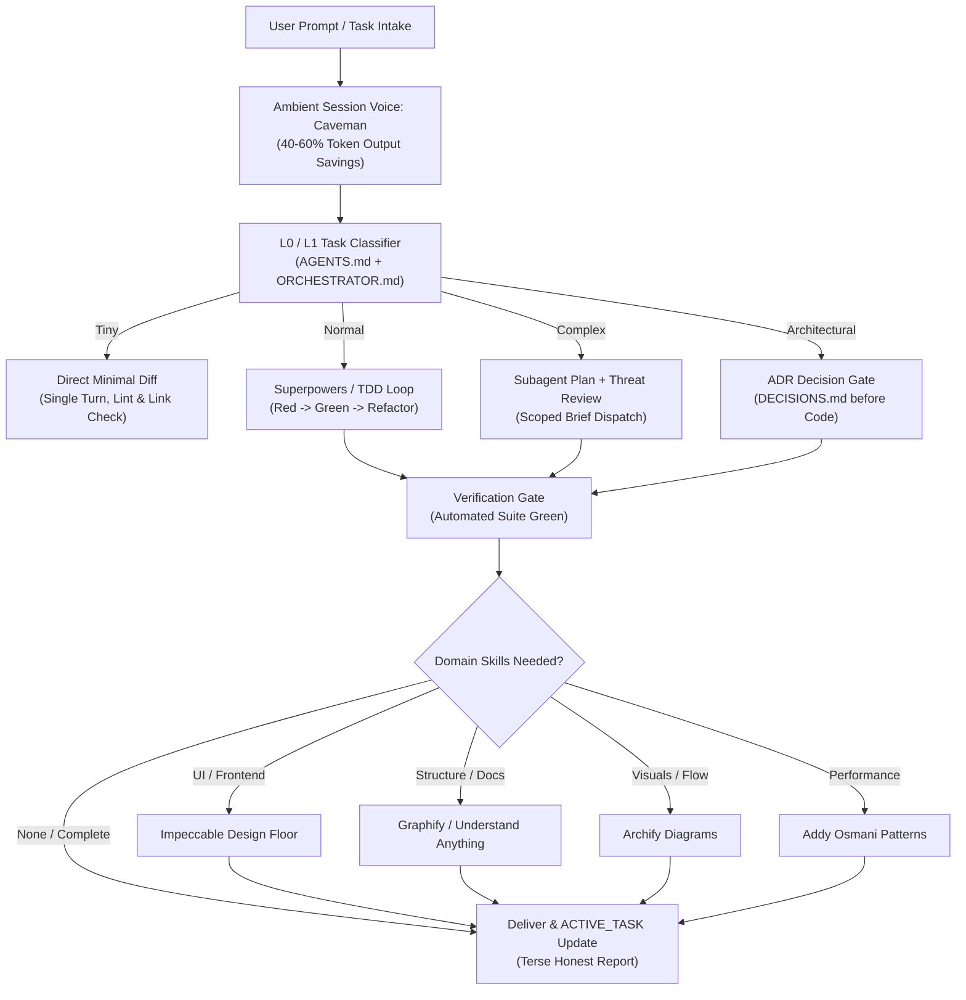

# Orchestra

> Intelligent agent orchestration for high-discipline software engineering and maximum token density.

[](#validation)
[](LICENSE)

Orchestra is a lightweight, portable orchestration framework for autonomous and assisted AI engineering. It couples **strict software engineering practices** (TDD, verification proofs, server-side security, ADRs) with an **aggressive token economy** powered by [Caveman](skills/caveman.md) that maximizes useful intelligence while strictly bounding prompt overhead.

---

## 🎯 Core Philosophy

### 1. The Token Density Equation
$$\text{Token Density} = \frac{\text{Verified Engineering Quality} \times \text{Decision Correctness}}{\text{Input Context} + \text{Reasoning Overhead} + \text{Conversational Fluff}}$$

Rather than stuffing 30,000 tokens of rules, documentation, and skill instructions into every prompt, Orchestra organizes context into **3 strictly bounded tiers**:

| Layer | Component | Context Cost | Lifecycle |
|---|---|---|---|
| **L0 Kernel** | [`AGENTS.md`](AGENTS.md) | ~500 tokens | Permanent system prompt (Includes Caveman) |
| **L1 Router** | [`ORCHESTRATOR.md`](ORCHESTRATOR.md) | ~400 tokens | Transient classification |
| **L2 Leaf** | [`skills/`](skills/) & [`protocols/`](protocols/) | ~600–900 tokens | Single leaf loaded on demand |

### 2. Ambient Session Voice: Caveman Engine
- **40–60% output token reduction** across all turns by stripping conversational filler, greetings, and recaps.
- Answers first, active voice, imperative grammar.
- Code blocks, terminal commands, file paths, numbers, and error traces remain 100% exact and verbatim.
- Auto-clarity fallback for security warnings, irreversible actions, and user questions.

### 3. Engineering Rigor
- **Test-Driven Development (TDD)**: Write failing test (RED), minimal implementation (GREEN), refactor.
- **Zero Unrun Claims**: Never assert that a bug is fixed or code is working without executing the test suite and recording exit codes.
- **Contract-First Truth**: Database schemas, API endpoints, and interfaces originate from verified project documents, never hallucinated.

---

## 🏗️ Architecture & Pipeline



---

## ⚡ Skill Routing Directory

Orchestra routes tasks between ambient session voices and domain-specialized skills on demand:

| Skill | Type | Trigger Intent | Documentation |
|---|---|---|---|
| **Caveman** | Ambient (Session) | Token saving, terse voice, zero fluff | [`skills/caveman.md`](skills/caveman.md) |
| **Superpowers** | Task-Level | Feature, bugfix, plan execution, TDD | [`skills/superpowers.md`](skills/superpowers.md) |
| **Impeccable** | Task-Level | UI components, design polish, a11y, responsive styling | [`skills/impeccable.md`](skills/impeccable.md) |
| **Graphify** | Task-Level | Structural graphs, dependency clusters, god nodes | [`skills/graphify.md`](skills/graphify.md) |
| **Understand Anything** | Task-Level | Codebase onboarding, visual interactive tours | [`skills/understand_anything.md`](skills/understand_anything.md) |
| **Archify** | Task-Level | Architecture diagrams, C4 models, Mermaid specs | [`skills/archify.md`](skills/archify.md) |
| **Addy Osmani** | Task-Level | Web performance, bundle optimization, Core Web Vitals | [`skills/addy_osmani.md`](skills/addy_osmani.md) |

---

## 📂 Repository Structure

```text
Orchestra/
├── AGENTS.md                          # L0 Constitutional Kernel + Caveman (Tokens: ~500)
├── ORCHESTRATOR.md                    # L1 Task & Skill Router (Tokens: ~400)
├── README.md                          # This documentation
├── LICENSE                            # MIT License
├── protocols/
│   ├── TOKEN_ECONOMY.md               # Context tiering & Caveman integration
│   ├── ENGINEERING_STANDARDS.md       # TDD cycles & verification gates
│   └── SUBAGENT_DISPATCH.md           # Scoped subagent dispatch schema
├── skills/
│   ├── caveman.md                     # Token saving ambient voice engine
│   ├── superpowers.md                 # TDD & structured execution adapter
│   ├── impeccable.md                   # Frontend craft & UX adapter
│   ├── graphify.md                    # Knowledge graph adapter
│   ├── understand_anything.md         # Visual onboarding adapter
│   ├── archify.md                     # System diagramming adapter
│   └── addy_osmani.md                 # Performance optimization adapter
├── templates/
│   ├── ACTIVE_TASK.md                 # Compact active state tracker
│   ├── ADR_TEMPLATE.md                # Lightweight architectural decision record
│   ├── EXECUTION_BRIEF.md             # Subagent task handoff contract
│   └── VERIFICATION_REPORT.md         # Empirical test evidence format
└── scripts/
    ├── install.sh                     # Deployment script (OpenCode, Antigravity, projects)
    └── validate.sh                    # Link integrity & token benchmark checker
```

---

## 🚀 Installation & Setup

### Option 1: Global OpenCode Installation
Deploys Orchestra as your default constitutional guide in OpenCode (with native Caveman plugin integration):
```bash
./scripts/install.sh opencode
```

### Option 2: Project-Level Installation
Deploys the kernel, router, protocols, and templates directly into your project repository:
```bash
./scripts/install.sh project /path/to/my-project
```

### Option 3: Antigravity CLI / IDE Installation
Deploys Orchestra rules into the Antigravity CLI environment:
```bash
./scripts/install.sh antigravity
```

---

## 🧪 Validation

Run the internal integrity validator to ensure all cross-references, templates, and token budgets pass:
```bash
bash scripts/validate.sh
```

---

## 📄 License

MIT © [S-Jrld](https://github.com/S-Jrld)
