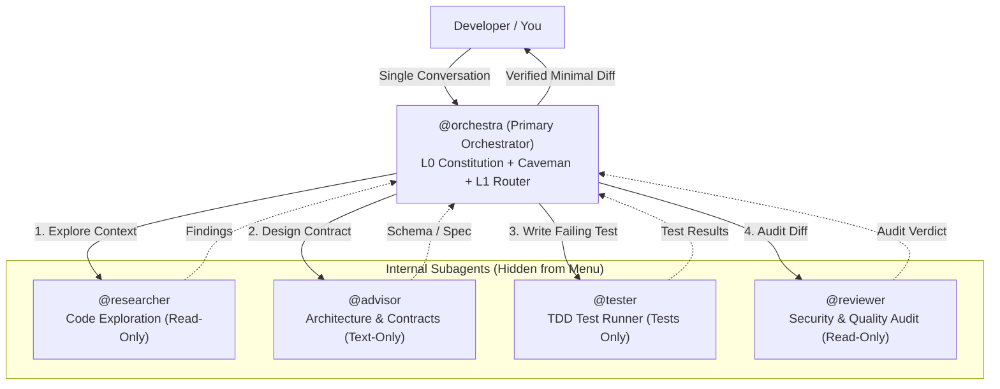

# 🎻 Orchestra

> **Intelligent single-agent orchestration for high-discipline software engineering and maximum token density.**

[](#-validation--integrity-check)
[](LICENSE)
[](#-ambient-session-voice-caveman-engine)
[](#-single-agent-architecture)

Orchestra is a lightweight, portable orchestration framework for AI-assisted and autonomous software development. It eliminates the chaos of sprawling multi-agent menus by presenting **one single primary agent (`@orchestra`)** that automatically coordinates specialized subagents, enforces rigorous engineering standards (TDD, verification proofs, server-side security, ADRs), and minimizes token usage using an ambient **Caveman token-saving engine**.

---

## 🎯 Single-Agent Architecture

Most agent setups overwhelm developers with a crowded menu of separate agents (`advisor`, `researcher`, `reviewer`, `tester`, `worker`). 

Orchestra solves this with a **Unified Single-Agent Model**:
- **You talk to only ONE primary agent (`@orchestra`, `mode: primary`)**.
- All specialist agents (`researcher`, `advisor`, `tester`, `reviewer`) are configured as internal subagents (**`mode: subagent`**)—hidden from your picker menu and orchestrated seamlessly behind the scenes.



---

## ⚡ Core Philosophy & Token Density

### The Token Density Equation
$$\text{Token Density} = \frac{\text{Verified Engineering Quality} \times \text{Decision Correctness}}{\text{Input Context} + \text{Reasoning Overhead} + \text{Conversational Fluff}}$$

Rather than dumping 30,000+ tokens of rules, documentation, and skill instructions into every prompt, Orchestra organizes context into **3 strictly bounded tiers**:

| Layer | Component | Context Cost | Lifecycle |
|---|---|---|---|
| **L0 Kernel** | [`AGENTS.md`](AGENTS.md) | ~500 tokens | Permanent system prompt (Includes Caveman rules) |
| **L1 Router** | [`ORCHESTRATOR.md`](ORCHESTRATOR.md) | ~400 tokens | Transient classification on task intake |
| **L2 Leaf** | [`skills/`](skills/) & [`protocols/`](protocols/) | ~600–900 tokens | Single leaf loaded strictly on demand |

### Ambient Session Voice: Caveman Engine
- **40–60% output token reduction** across all turns by stripping greetings, hedging, recaps, and pleasantries.
- Answers first, active voice, imperative grammar.
- Code blocks, terminal commands, file paths, numbers, and error traces remain **100% exact and verbatim**.
- Automatic clarity fallback for security warnings, irreversible actions, and user questions.

---

## 🚀 Quickstart (60 Seconds)

### 1. Clone & Validate
```bash
git clone https://github.com/S-Jrld/Orchestra.git
cd Orchestra
bash scripts/validate.sh
```

### 2. Install to Your Preferred Environment

#### Option A: Global OpenCode Installation (Zero-Config)
Deploys Orchestra as your default constitutional guide in OpenCode, installs `@orchestra` as your single primary agent, and sets all specialist subagents to `mode: subagent`:
```bash
./scripts/install.sh opencode
```

#### Option B: Standalone Project Installation
Deploys the kernel, router, agents, protocols, and templates directly into any project repository:
```bash
./scripts/install.sh project /path/to/my-project
```

#### Option C: Antigravity CLI / IDE Installation
Deploys Orchestra rules into the Antigravity CLI rules directory:
```bash
./scripts/install.sh antigravity
```

---

## 📖 Full Usage Guide

Once installed, Orchestra is completely hands-off. You do not need to memorize complex commands or select different subagents—**simply talk to `@orchestra` in plain English**.

### 1. Everyday Development Workflows

#### Scenario A: Adding a Feature or Fixing a Bug (TDD Loop)
Just describe what you want built:
> *"Add JWT token refresh endpoint in `auth/router.py`"*

What Orchestra does:
1. Classifies task as **`Normal`** tier.
2. Triggers [`skills/superpowers.md`](skills/superpowers.md).
3. Dispatches `@tester` to write an automated failing test (**RED**).
4. Implements the minimal code required to satisfy the contract (**GREEN**).
5. Dispatches `@reviewer` to verify no credentials, regressions, or scope creep exist.
6. Runs the automated test suite and reports verified proof.

#### Scenario B: UI & Frontend Craft
Describe your interface task:
> *"Build a responsive navigation header for mobile viewports"*

What Orchestra does:
1. Routes to [`skills/impeccable.md`](skills/impeccable.md).
2. Adheres to the 4 mandatory UI states: `Loading`, `Success`, `Error` (with retry action), and `Empty`.
3. Verifies semantic HTML, WCAG AA color contrast, and keyboard navigation.

#### Scenario C: Exploring an Unfamiliar Codebase
When joining a new project:
> *"Where do I start in this repo? What are the core models?"*

What Orchestra does:
1. Dispatches `@researcher` with read-only tools to map call trees and locate entry points.
2. Triggers [`skills/understand_anything.md`](skills/understand_anything.md) or [`skills/graphify.md`](skills/graphify.md) to generate dependency graphs and identify god-nodes.

---

### 2. Controlling the Token Economy (Caveman Commands)

Orchestra speaks in terse, high-density Caveman voice by default. You can adjust the compression level at any time using slash commands:

| Command | Mode | Description | Savings |
|---|---|---|---|
| `/caveman` | Default Terse | Active voice, fluff stripped, code verbatim. | ~40–50% |
| `/ultracave` | Extreme Density | Fragment style; each technical fact stated once. | ~60–70% |
| `/megacave` | Classical Chinese | Classical Chinese (文言文) mode for ultra-compact payloads. | ~75% |
| `stop caveman` | Full Prose | Disables Caveman voice; resumes standard conversational sentences. | Baseline |

---

### 3. Task Execution Tiers & Stop Conditions

Orchestra bounds every task with clear execution tiers and hard stop conditions:

| Tier | Scope | Required Gates | Stop Condition |
|---|---|---|---|
| **Tiny** | Typo, naming, comment, formatting | Diff re-read, scope check, clean lint | Diff clean, zero scope creep |
| **Normal** | Feature, bugfix, schema, endpoint | Red-Green TDD, regression suite pass | Suite green, behavior verified |
| **Complex** | Cross-module, auth, breaking API | Threat pass, rollback plan, scoped subagent brief | Confirmed plan, ADR logged, green tests |
| **Architectural** | Subsystem, new database, framework | Trade-off matrix, ADR approved before code | Approved ADR in `DECISIONS.md` |

---

### 4. Updating an Existing Installation

If you already cloned Orchestra and installed it to OpenCode, update to the latest release in two commands:

```bash
cd Orchestra
git pull origin main
./scripts/install.sh opencode
```

This automatically:
- Pulls latest agent updates, protocols, and skills.
- Backs up your existing configuration.
- Keeps `@orchestra` primary while ensuring all specialist agents remain set to `mode: subagent`.

---

## ⚡ Skill Routing Directory

Orchestra routes tasks between ambient session voices and domain-specialized skills on demand:

| Skill | Type | Trigger Intent | Documentation |
|---|---|---|---|
| **Caveman** | Ambient (Session) | Token saving, terse voice, zero fluff | [`skills/caveman.md`](skills/caveman.md) |
| **Superpowers** | Task-Level | Feature, bugfix, plan execution, TDD | [`skills/superpowers.md`](skills/superpowers.md) |
| **Impeccable** | Task-Level | UI components, design polish, a11y, responsive styling | [`skills/impeccable.md`](skills/impeccable.md) |
| **Graphify** | Task-Level | Structural graphs, dependency clusters, god nodes | [`skills/graphify.md`](skills/graphify.md) |
| **Understand Anything** | Task-Level | Codebase onboarding, visual interactive tours | [`skills/understand_anything.md`](skills/understand_anything.md) |
| **Archify** | Task-Level | Architecture diagrams, C4 models, Mermaid specs | [`skills/archify.md`](skills/archify.md) |
| **Addy Osmani** | Task-Level | Web performance, bundle optimization, Core Web Vitals | [`skills/addy_osmani.md`](skills/addy_osmani.md) |

---

## 📂 Repository Structure

```text
Orchestra/
├── AGENTS.md                          # L0 Constitutional Kernel + Caveman (Tokens: ~500)
├── ORCHESTRATOR.md                    # L1 Task & Skill Router (Tokens: ~400)
├── README.md                          # Full guide and architecture overview
├── LICENSE                            # MIT License
├── agents/
│   ├── orchestra.md                   # Single primary agent (mode: primary)
│   ├── researcher.md                  # Codebase discovery subagent (mode: subagent)
│   ├── advisor.md                     # Architecture & contracts subagent (mode: subagent)
│   ├── tester.md                      # TDD test-runner subagent (mode: subagent)
│   └── reviewer.md                    # Threat & quality audit subagent (mode: subagent)
├── protocols/
│   ├── TOKEN_ECONOMY.md               # Context tiering & Caveman integration
│   ├── ENGINEERING_STANDARDS.md       # TDD cycles & verification gates
│   └── SUBAGENT_DISPATCH.md           # Scoped subagent dispatch schema
├── skills/
│   ├── caveman.md                     # Token saving ambient voice engine
│   ├── superpowers.md                 # TDD & structured execution adapter
│   ├── impeccable.md                   # Frontend craft & UX adapter
│   ├── graphify.md                    # Knowledge graph adapter
│   ├── understand_anything.md         # Visual onboarding adapter
│   ├── archify.md                     # System diagramming adapter
│   └── addy_osmani.md                 # Performance optimization adapter
├── templates/
│   ├── ACTIVE_TASK.md                 # Compact active state tracker
│   ├── ADR_TEMPLATE.md                # Lightweight architectural decision record
│   ├── EXECUTION_BRIEF.md             # Subagent task handoff contract
│   └── VERIFICATION_REPORT.md         # Empirical test evidence format
└── scripts/
    ├── install.sh                     # Zero-config deployment script
    └── validate.sh                    # Link integrity, agent modes & token benchmark checker
```

---

## 🧪 Validation & Integrity Check

Orchestra includes an automated validation script that checks:
1. All required constitutional files, protocols, skills, templates, and agents exist.
2. Agent permissions (`orchestra.md` is `mode: primary`; all specialists are `mode: subagent`).
3. 100% of internal Markdown links resolve cleanly.
4. L0 and L1 token budgets remain strictly bounded.

```bash
bash scripts/validate.sh
```

---

## 📄 License

MIT © [S-Jrld](https://github.com/S-Jrld)
