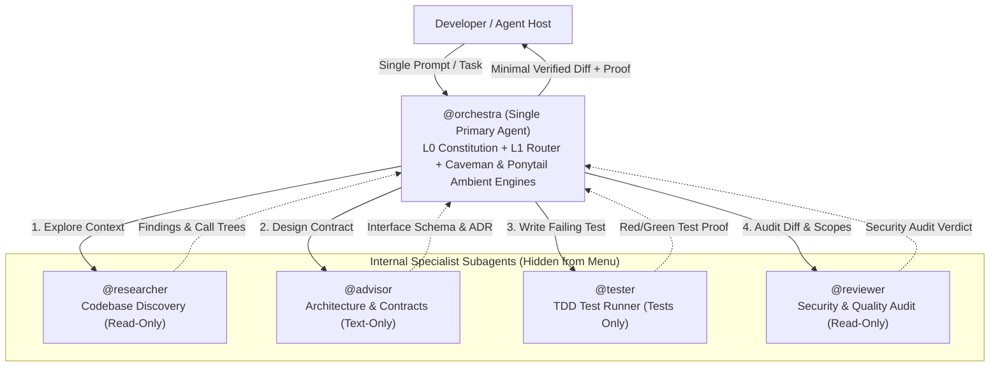
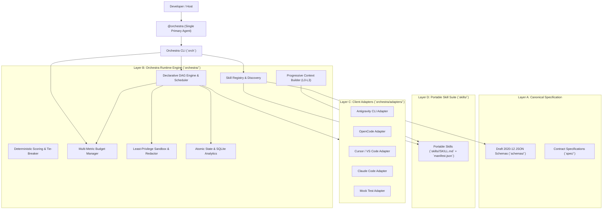
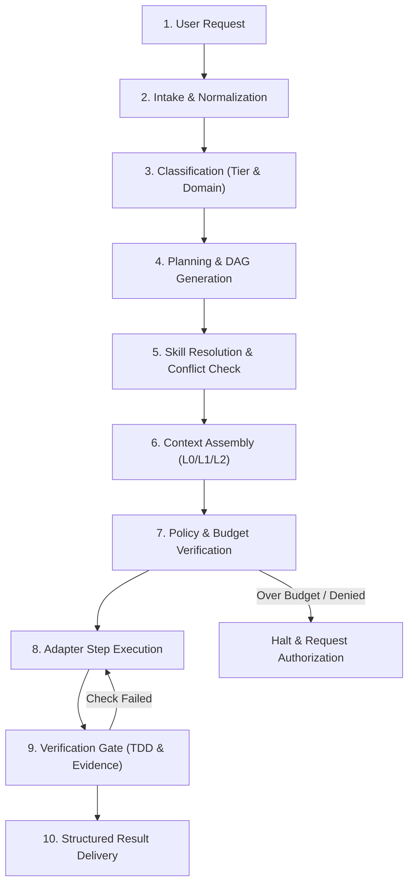

# 🎻 Orchestra

> **Model-Agnostic AI Orchestration Framework for High-Discipline Software Engineering and Maximum Token Density.**

[](#-validation--automated-testing)
[](#-validation--automated-testing)
[](#-token-economy--context-density)
[](#-single-agent-architecture)
[](#-client-adapter-ecosystem)
[-brightgreen.svg)](#-repository-structure)
[](LICENSE)

Orchestra transforms AI-assisted software development from unstructured, conversational prompt chains into a **versioned, verifiable, secure, and token-efficient engineering system**. It eliminates multi-agent menu chaos by presenting **one single primary agent (`@orchestra`)** that coordinates internal specialist workers, enforces rigorous engineering standards (Red-Green TDD, verification proofs, server-side security, ADRs), progressively loads context, and tracks historical metrics via a local SQLite analytics engine.

---

## 📑 Table of Contents
- [🎯 Single-Agent Architecture](#-single-agent-architecture)
- [🏛️ 4-Layer Decoupled Framework](#️-4-layer-decoupled-framework)
- [🔄 Deterministic Execution Lifecycle](#-deterministic-execution-lifecycle)
- [🚀 Quickstart (60 Seconds)](#-quickstart-60-seconds)
- [🔌 Client Adapter Ecosystem](#-client-adapter-ecosystem)
  - [Google Antigravity CLI / IDE](#1-google-antigravity-cli--ide)
  - [OpenCode](#2-opencode)
  - [Cursor IDE & VS Code](#3-cursor-ide--vs-code)
  - [Anthropic Claude Code CLI](#4-anthropic-claude-code-cli)
  - [Standalone Project Repository](#5-standalone-project-repository)
- [🛠️ Orchestra CLI (`orch`) Reference](#️-orchestra-cli-orch-reference)
- [📊 SQLite Analytics & Observability](#-sqlite-analytics--observability)
- [⚡ Token Economy & Context Density](#-token-economy--context-density)
  - [Progressive Context Layers (L0–L3)](#the-context-tiering-model)
  - [Ambient Caveman Voice Commands](#ambient-session-voice-caveman-engine)
  - [Empirical Benchmark Results](#empirical-benchmark-results)
- [🛡️ Engineering Discipline & Security](#️-engineering-discipline--security)
  - [Execution Tiers & Stop Conditions](#execution-tiers)
  - [Runtime Security Boundaries](#runtime-security-guardrails)
- [📦 Portable Skill Suite](#-portable-skill-suite)
- [📚 Complete Documentation Sitemap](#-complete-documentation-sitemap)
- [🧪 Validation & Automated Testing](#-validation--automated-testing)
- [📄 License & Attribution](#-license--attribution)

---

## 🎯 Single-Agent Architecture

Most AI agent configurations overwhelm developers with sprawling menus of separate subagents (`advisor`, `researcher`, `reviewer`, `tester`, `worker`). Developers waste context and cognitive effort manually switching between agents and repeating prompts.

Orchestra solves this with a **Unified Single-Primary-Agent Paradigm**:
- **You interact with only ONE primary agent (`@orchestra`, `mode: primary`)**.
- All specialist workers (`researcher`, `advisor`, `tester`, `reviewer`) are configured as internal subagents (**`mode: subagent`**)—hidden from the menu picker and coordinated autonomously behind the scenes with bounded task contracts.



---

## 🏛️ 4-Layer Decoupled Framework

Orchestra is constructed on a **4-layer decoupled architecture**, ensuring vendor-neutrality, model-agnostic execution, and zero unnecessary context overhead:



1. **Layer A — Canonical Specification ([`spec/`](spec/) & [`schemas/`](schemas/))**: Machine-readable Draft 2020-12 schemas for skill manifests, agent profiles, workflows, task contracts, execution policies, structured results, verification reports, and run records.
2. **Layer B — Orchestra Runtime Engine ([`orchestra/`](orchestra/))**: Zero-dependency Python 3 standard library runtime providing topological DAG scheduling (`graphlib.TopologicalSorter`), shared-file conflict detection, hard budget quotas, and path sandboxing.
3. **Layer C — Client Adapters ([`orchestra/adapters/`](orchestra/adapters/))**: Standardized translation layer bridging Orchestra definitions to Google Antigravity, OpenCode, Cursor, and Claude Code.
4. **Layer D — Portable Skills Suite ([`skills/`](skills/))**: Standard portable skill packages containing instructions, canonical metadata, and provenance.

---

## 🔄 Deterministic Execution Lifecycle

Every task dispatched through Orchestra follows a verified **10-stage deterministic lifecycle**:



---

## 🚀 Quickstart (60 Seconds)

### 1. Clone & Verify
```bash
git clone https://github.com/S-Jrld/Orchestra.git
cd Orchestra
bash scripts/validate.sh
```

### 2. Check System Health
Run `orch doctor` to verify schemas, skills, and client adapter environments:
```bash
./bin/orch doctor
```

```text
=== Orchestra Health Check ===
✓ Schemas directory: OK
✓ Skills directory:  OK
✓ OpenCode environment: READY
✓ Antigravity environment: READY
```

---

## 🔌 Client Adapter Ecosystem

Orchestra natively connects to 5 execution environments without altering your project's canonical workflows:

### 1. Google Antigravity CLI / IDE
Deploys rules and portable workspace skills into Antigravity convention directories:
```bash
./bin/orch install antigravity
```
- **Workspace Skills**: Staged into `.agents/skills/<skill-name>/SKILL.md`.
- **Global Constitution**: Copied to `~/.gemini/antigravity-cli/rules/ORCHESTRA_AGENTS.md`.
- **Plugin Packaging**: Generates Antigravity plugin manifest via `AntigravityAdapter.package_plugin()`.
- **Documentation**: [Google Antigravity CLI Guide](docs/antigravity-cli.md).

### 2. OpenCode
Configures `@orchestra` as your single primary agent while keeping specialist subagents internal:
```bash
./bin/orch install opencode
```
- **Config Directory**: `~/.config/opencode/`.
- **Primary Agent**: `agents/orchestra.md` installed as `mode: primary`.
- **Specialist Subagents**: All specialists configured as `mode: subagent` (hidden from picker).
- **Documentation**: [OpenCode Integration Guide](docs/opencode.md).

### 3. Cursor IDE & VS Code
Generates workspace rules for Cursor Composer and VS Code AI:
```bash
./bin/orch install cursor
```
- **Rules File**: Writes `.cursor/rules/orchestra.mdc` with `alwaysApply: true`.
- **Context Synchronization**: Automatically embeds the L0 constitution and L1 router into Cursor's system prompts.
- **Documentation**: [Cursor & VS Code Integration Guide](docs/cursor.md).

### 4. Anthropic Claude Code CLI
Integrates with Claude Code CLI terminal sessions:
```bash
./bin/orch install claude
```
- **Memory File**: Generates root `CLAUDE.md` incorporating Orchestra engineering protocols, TDD loops, and token limits.
- **Skill Staging**: Deploys skills into `.claude/skills/`.
- **Documentation**: [Claude Code Integration Guide](docs/claude.md).

### 5. Standalone Project Repository
Deploys the full constitutional suite into any project workspace:
```bash
./bin/orch install project /path/to/my-project
```

### Adapter Feature Matrix

| Feature | Antigravity CLI | OpenCode | Cursor IDE | Claude Code | Mock Engine |
|---|:---:|:---:|:---:|:---:|:---:|
| **Single-Agent Model** | ✅ Native | ✅ Native | ✅ Rules | ✅ Memory | ✅ Native |
| **Subagent Coordination** | ✅ Native | ✅ Native | ✅ Composer | ⚠️ Single CLI | ✅ In-Memory |
| **Structured Output Schema** | ✅ `--json-schema` | ⚠️ Emulated | ⚠️ Emulated | ⚠️ Emulated | ✅ Native |
| **Permission Sandboxing** | ✅ `--sandbox` | ✅ Config | ⚠️ Terminal | ✅ Native Gates | ✅ Allowlist |
| **Usage & Cost Tracking** | ✅ Native | ⚠️ Estimated | ⚠️ Estimated | ✅ Native | ✅ Deterministic |

---

## 🛠️ Orchestra CLI (`orch`) Reference

Orchestra includes an executable CLI (`bin/orch`) with full JSON support (`--json`) for automated pipelines, CI/CD, and local administration.

```bash
usage: orch [-h] [--json] <command> [args]
```

### Core Commands

| Command | Description | Example |
|---|---|---|
| `version` | Display version and runtime info | `orch version --json` |
| `doctor` | Verify prerequisites and adapter health | `orch doctor` |
| `validate` | Run full repository integrity validation | `orch validate` |
| `benchmark` | Run empirical token-efficiency benchmark | `orch benchmark` |

### Skills Management (`orch skills`)

```bash
# List all discovered skills in workspace and bundle
orch skills list

# Inspect detailed metadata for a specific skill
orch skills inspect superpowers

# Search skills by keyword or intent
orch skills search "responsive frontend"

# Validate all skill manifests against Draft 2020-12 schema
orch skills validate
```

### Deterministic Routing (`orch route`)

```bash
# Deterministically route a task with an explainability trace
orch route --task "Add JWT token refresh endpoint in auth/router.py" --explain

# Route with custom token budget
orch route --task "Fix typo in docstring" --budget 1500 --json
```

### Declarative Workflows (`orch workflow`)

```bash
# List available workflows
orch workflow list

# Validate a workflow definition file against JSON schema
orch workflow validate workflows/feature-tdd.json

# Execute workflow via target adapter (mock, opencode, antigravity, cursor, claude)
orch workflow run workflows/feature-tdd.json --adapter mock
```

### Execution State & Run Recovery (`orch run`)

```bash
# List historical execution runs
orch run list

# Check status of an active or completed run
orch run status run_5f8c4f80b54d

# Inspect full step records, tokens, and errors
orch run inspect run_5f8c4f80b54d --json

# Cancel an active run safely
orch run cancel run_5f8c4f80b54d
```

### Deployment & Uninstallation (`orch install` / `orch uninstall`)

```bash
# Deploy with dry-run simulation
orch install cursor --dry-run
orch install opencode --dry-run

# Live deployment
orch install antigravity

# Safe rollback and uninstallation
orch uninstall opencode
```

---

## 📊 SQLite Analytics & Observability

Orchestra features a local-first **SQLite Analytics Engine** (`.orchestra/analytics.db`) providing instant queries across thousands of historical runs.

```bash
# View comprehensive aggregate statistics
orch run stats
```

```text
=== Orchestra Execution Analytics (SQLite) ===
Total Runs:       22 (11 succeeded, 9 failed, 2 cancelled)
Success Rate:     50.0%
Tokens Consumed:  16,500 (Cost: $0.0000)
Avg Run Duration: 0.25s

Runs by Tier:
  • Normal        : 12 runs (avg 1375.0 tokens)
  • Tiny          : 10 runs (avg 0 tokens)

Steps by Role:
  • advisor       : 3 total steps (0 failed)
  • orchestra     : 12 total steps (0 failed)
  • researcher    : 12 total steps (0 failed)
  • reviewer      : 3 total steps (0 failed)
  • tester        : 13 total steps (9 failed)
```

```bash
# Query runs with structured filters
orch run query --status succeeded --tier Normal --limit 5

# Rebuild SQLite index from disk JSON files
orch run reindex
```

---

## ⚡ Token Economy & Context Density

Orchestra optimizes the **Token Density Equation**:

$$\text{Token Density} = \frac{\text{Verified Engineering Quality} \times \text{Decision Correctness}}{\text{Input Context} + \text{Reasoning Overhead} + \text{Conversational Fluff}}$$

### The Context Tiering Model

Rather than dumping 30,000+ tokens of monolithic rules into every prompt, Orchestra loads context on demand in **strictly bounded tiers**:

| Layer | Component | Context Cost | Lifecycle |
|---|---|:---:|---|
| **L0 Kernel** | [`AGENTS.md`](AGENTS.md) | ~700 tokens | Permanent constitutional system prompt (includes Caveman & Ponytail engines) |
| **L1 Router** | [`ORCHESTRATOR.md`](ORCHESTRATOR.md) | ~400 tokens | Transient classification and skill routing table |
| **L2 Leaf** | [`skills/<id>/SKILL.md`](skills/) | ~600–900 tokens | Single active domain skill loaded strictly on demand |
| **L3 Artifacts** | [`templates/`](templates/) | Variable | Execution briefs, ADRs, test results, and verification proofs |

### Ambient Session Voice: Caveman Engine

Orchestra speaks in terse, high-density Caveman voice by default:
- **40–60% output token reduction** across all conversational turns by eliminating pleasantries, recaps, filler words, and ceremony.
- Answers first, active voice, imperative grammar.
- Code blocks, commands, file paths, numbers, and stack traces remain **100% exact and verbatim**.
- Automatic clarity fallback for security boundaries, irreversible actions, and user questions.

You can adjust compression at any time using slash commands:
- `/caveman`: Default terse mode (~40–50% reduction).
- `/ultracave`: Extreme density; technical facts stated once (~60–70% reduction).
- `/megacave`: Classical Chinese (文言文) mode for ultra-compact payloads (~75% reduction).
- `stop caveman`: Disables Caveman voice; resumes standard conversational prose.

### Ambient Code Quality: Ponytail Engine

Orchestra enforces the **Smallest Complete Change Ladder** on every code edit via the Ponytail engine:
- **53% code reduction, 45% tokens saved, 98% test coverage** for risky logic without speculative bloat.
- **Decision Ladder**: Does it need to exist? (YAGNI) → Already in codebase? (Reuse) → Stdlib/platform feature? → Installed dependency? → Clear one-liner? → Minimum code that works.
- **Non-negotiable floors**: Never cut validation at trust boundaries, error handling, security/auth checks, a11y standards (WCAG AA), or automated tests.
- **Technical Debt Ledger**: Intentional trade-offs are documented with `shortcut: <the limit>, <when to upgrade>`.
- **Response Sign-off**: Every code turn concludes with what was skipped and known operational ceilings.

Specialist commands:
- `/ponytail`: Enforces smallest complete change (default).
- `/ponytail-review`: Strict diff audit (correct, safe, load-resilient, tested, lean).
- `/ponytail-audit`: Full codebase scan for bloat, dead code, and merge/delete candidates.
- `/ponytail-debt`: Scan and format all marked shortcuts into a prioritized debt ledger.

### Empirical Benchmark Results

Measured via [`orch benchmark`](tests/benchmarks/test_benchmarks.py) across 6 representative engineering scenarios:

| Scenario | Tier | Monolithic Prompt | Orchestra Tiered | Token Savings | Status |
|---|:---:|:---:|:---:|:---:|:---:|
| Documentation Typo Fix | `Tiny` | 10,728 tokens | 2,602 tokens | **-75.7%** | PASS |
| Normal Feature TDD | `Complex` | 10,728 tokens | 2,602 tokens | **-75.7%** | PASS |
| Frontend Responsive UI | `Normal` | 10,728 tokens | 2,617 tokens | **-75.6%** | PASS |
| Codebase Exploration | `Architectural` | 10,728 tokens | 2,497 tokens | **-76.7%** | PASS |
| Database Query Profiling | `Normal` | 10,728 tokens | 2,661 tokens | **-75.2%** | PASS |
| Cross-Module Auth Refactor | `Complex` | 10,728 tokens | 2,219 tokens | **-79.3%** | PASS |
| **Average Across Scenarios** | — | **10,728 tokens** | **2,533 tokens** | **-76.4%** | **PASS** |

---

## 🛡️ Engineering Discipline & Security

### Execution Tiers

Orchestra bounds every task with clear execution tiers and hard stop conditions:

| Tier | Scope | Required Gates | Stop Condition |
|---|---|---|---|
| **Tiny** | Typo, naming, comment, formatting | Diff re-read, scope check, clean lint | Diff clean, zero scope creep |
| **Normal** | Feature, bugfix, schema, endpoint | Red-Green TDD, regression suite pass | Suite green, behavior verified |
| **Complex** | Cross-module, auth, breaking API | Threat pass, rollback plan, scoped brief | Confirmed plan, ADR logged, green tests |
| **Architectural** | Subsystem, new database, framework | Trade-off matrix, ADR approved before code | Approved ADR in `DECISIONS.md` |

### Runtime Security Guardrails

Orchestra treats documentation and prompts as guidelines, not security boundaries. Security is enforced at runtime by [`SecurityPolicyEngine`](orchestra/security/policy.py):

1. **Path Traversal Sandboxing**: [`PathSandbox`](orchestra/security/sandbox.py) blocks traversal attacks (`../`, `/etc/`, `/root/`, `~/.ssh/`) outside allowed workspace roots.
2. **Protected Security Patterns**: Hard blocks on modifying sensitive targets:
   - `**/.git/**`
   - `**/.env*`
   - `**/id_rsa*`
   - `**/credentials*`
3. **Secret Redaction**: [`SecretRedactor`](orchestra/security/sandbox.py) sanitizes API keys (`ghp_...`, `sk-proj-...`, bearer tokens) before briefs, logs, or run records are written to disk.
4. **Least-Privilege Agent Masks**: Permissions enforced at runtime; specialist agents (e.g. `@researcher`) are locked to read-only actions.

---

## 📦 Portable Skill Suite

All skills conform to the canonical portable layout (`skills/<id>/SKILL.md` + `manifest.json`):

| Skill ID | Kind | Trigger Intents & Keywords | Upstream Source & License |
|---|---|---|---|
| [`caveman`](skills/caveman/SKILL.md) | `session-ambient` | Terse mode, token economy, compression | Native Orchestra Engine (MIT) |
| [`superpowers`](skills/superpowers/SKILL.md) | `task-leaf` | Feature, bugfix, TDD red/green, plan execution | `obra/superpowers` (MIT) |
| [`impeccable`](skills/impeccable/SKILL.md) | `task-leaf` | UI components, design polish, a11y, responsive | `pbakaus/impeccable` (MIT) |
| [`ui_ux_pro_max`](skills/ui_ux_pro_max/SKILL.md) | `task-leaf` | Design systems, palettes, style pairing, charts | `nextlevelbuilder/ui-ux-pro-max` (MIT) |
| [`graphify`](skills/graphify/SKILL.md) | `task-leaf` | Structural graphs, dependency clusters, god nodes | Native Knowledge Graph Spec (MIT) |
| [`understand_anything`](skills/understand_anything/SKILL.md) | `task-leaf` | Codebase onboarding, functional mental model | `Egonex-AI/Understand-Anything` (MIT) |
| [`archify`](skills/archify/SKILL.md) | `task-leaf` | Architecture diagrams, C4 models, Mermaid specs | `tt-a1i/archify` (MIT) |
| [`addy_osmani`](skills/addy_osmani/SKILL.md) | `task-leaf` | Web performance, bundle optimization, Core Web Vitals | `addyosmani/agent-skills` (MIT) |
| [`ponytail`](skills/ponytail/SKILL.md) | `task-leaf` | Minimal code, anti-bloat, YAGNI, code review, debt tracking | `DietrichGebert/ponytail` (MIT) |

---

## 📚 Complete Documentation Sitemap

### Core Architecture & Specifications
- [Framework Architecture Overview](docs/architecture.md)
- [Implementation Baseline & Audit Report](docs/implementation-baseline.md)
- [Canonical Specification & Schemas](docs/specification.md)
- [Skill Registry & Discovery Engine](docs/skill-registry.md)
- [Deterministic Routing Pipeline](docs/routing.md)
- [Declarative DAG Workflows](docs/workflows.md)
- [Context Economy & Token Density](docs/context-economy.md)
- [Multi-Metric Budget Management](docs/budget-management.md)
- [Runtime Security & Sandboxing Model](docs/security-model.md)

### Client Adapters
- [Client Adapters Architecture](docs/adapters.md)
- [Google Antigravity CLI Integration Guide](docs/antigravity-cli.md)
- [OpenCode Integration Guide](docs/opencode.md)
- [Cursor & VS Code Integration Guide](docs/cursor.md)
- [Claude Code CLI Integration Guide](docs/claude.md)

### Operations & Release Quality
- [Installation, Updates & Rollback Guide](docs/installation.md)
- [Troubleshooting & Error Codes](docs/troubleshooting.md)
- [Token Efficiency Benchmarking](docs/benchmarking.md)
- [Development Roadmap](docs/roadmap.md)

### Formal Specifications (`spec/`)
- [Specification Overview](spec/README.md)
- [Execution Lifecycle Specification](spec/lifecycle.md)
- [Versioning & Compatibility Policy](spec/versioning.md)
- [Adapter Compatibility Contract](spec/compatibility.md)
- [Security & Trust Boundaries](spec/security.md)
- [Standard Error Codes](spec/errors.md)

---

## 🧪 Validation & Automated Testing

### 1. Repository Baseline Validator
Checks required files, single-agent contracts, link integrity, and token budgets:
```bash
bash scripts/validate.sh
```

### 2. Automated Conformance Test Suite (58 Tests)
Executes unit, integration, adapter, security, regression, and benchmark suites:
```bash
PYTHONPATH=. python3 -m unittest discover -s tests -p "test_*.py" -v
```

---

## 📄 License & Attribution

Orchestra is licensed under the [MIT License](LICENSE).

Upstream skills and adapters retain their respective open-source licenses as documented in their canonical manifests and the [Implementation Baseline](docs/implementation-baseline.md).

---

<p align="center">
  <b>Built for developers who demand high engineering discipline and maximum token density from their AI agents.</b>
</p>
