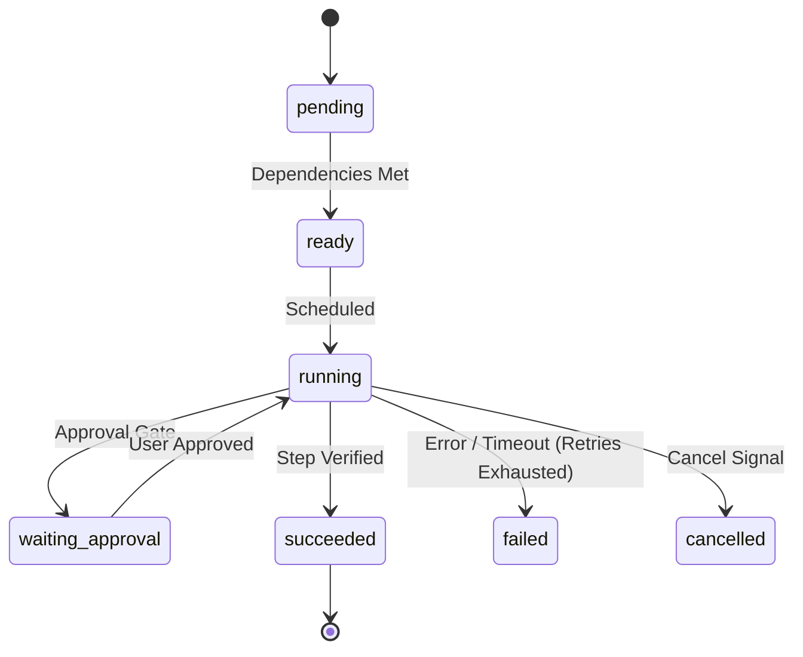

# Declarative Workflow DAG Engine

Orchestra models multi-step engineering tasks as declarative Directed Acyclic Graphs (DAGs) rather than loose conversational prompts.

## Workflow Lifecycle & State Machine



## Step Definition Structure

Workflows are declared in versioned JSON definitions conforming to [`schemas/workflow-definition.json`](../schemas/workflow-definition.json):

```json
{
  "id": "explore",
  "name": "Explore codebase context and signatures",
  "agent_role": "researcher",
  "required_skills": ["understand_anything"],
  "dependencies": [],
  "target_files": ["src/auth.py"],
  "verification_command": "true"
}
```

## Concurrency & Conflict Avoidance

- Steps execute in parallel up to `max_workers` when their dependencies are satisfied.
- **Shared-File Isolation**: The scheduler detects if two ready steps touch overlapping `target_files` and serializes them to prevent race conditions or merge conflicts.

## CLI Execution

```bash
# Validate workflow definition
orch workflow validate workflows/feature-tdd.json

# Execute workflow with Mock adapter
orch workflow run workflows/feature-tdd.json --adapter mock
```
