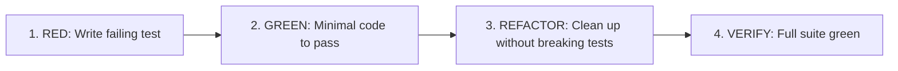

# PROTOCOL: ENGINEERING STANDARDS & QUALITY GATES

> Non-negotiable software engineering discipline for autonomous and assisted development.

## 1. Test-Driven Development (TDD) Gate

For all `Normal` and `Complex` code modifications:



1. **RED**: Write an automated test asserting the expected behavior or reproducing the bug. Run it. Confirm it fails for the expected reason.
2. **GREEN**: Write the minimal code necessary to make the failing test pass. Do not add speculative extras.
3. **REFACTOR**: Simplify code structure, remove duplication, and ensure readability while keeping the test suite green.
4. **VERIFY**: Run both the new test and the existing regression suite.

## 2. Ponytail Minimalist Code Engine (Smallest Complete Change)

Every implementation must take the first step on the ladder that fully works:
1. **Does it need to exist?** Skip unasked flexibility, options, and abstractions (YAGNI).
2. **Already in this codebase?** Reuse existing helpers, components, services, and idioms.
3. **Standard library or platform feature?** Use language or runtime built-ins before custom utilities.
4. **Installed dependency?** Use what is already in dependencies; never add a package for trivial logic.
5. **Clear one-liner?** If readable at a glance without decoding, keep it to a single line.
6. **Otherwise:** Write the minimum code that passes tests.

### Non-Negotiable Floors:
Never cut:
- Validation at trust boundaries
- Error handling preventing data loss or crashes
- Security, authentication, and authorization checks
- Accessibility standards (WCAG AA)
- Automated tests for new non-trivial logic

### Technical Debt Ledger:
When taking an intentional shortcut with a known ceiling, document it:
```text
shortcut: <the limit>, <when to upgrade>
```

### Response Sign-Off:
Always conclude code modifications with:
1. What was skipped or omitted.
2. Known risks, ceilings, or operational trade-offs.

## 3. Verification Before Completion

- **Zero Unrun Claims**: Never claim a feature works or a bug is resolved without executing the verification command on disk.
- **Evidence Requirement**: Every completion report must provide:
  - Exact command executed (e.g. `pytest tests/test_auth.py`, `npm run test`)
  - Exit code (`0` for success)
  - Relevant summary output lines (passed tests count, duration)
- **If checks cannot run**: State explicitly why (e.g. missing external service, environment dependency) and list the manual command for the user.

## 4. Contract & Interface Rigor

- **Single Source of Truth**: All public schemas, API endpoints, and database models must match documented contracts (`API_SPEC.md`, `DATABASE_SCHEMA.md`, or OpenAPI specs).
- **Never Guess Schemas**: If a table column or endpoint parameter is unknown, inspect the migration files, schema definitions, or ask the user.
- **Fail Fast & Typed**: Validate all inputs at runtime boundaries using schemas (Pydantic, Zod, TypeBox, etc.).

## 5. Security & Safety Checklist

Before committing any diff, execute this 4-point threat pass:
1. **Secrets**: Zero API keys, database credentials, JWT secrets, or sensitive environment values in code or commit logs.
2. **Input Sanitization**: All user-supplied data validated against strict schemas; SQL injection, XSS, and command injection vectors blocked.
3. **Authorization**: Server-side authorization check on every mutation; never rely on UI hiding or client-asserted roles.
4. **Auditability**: Sensitive or state-changing operations recorded in audit logs with timestamp and actor identity.

## 6. Architectural Decision Records (ADRs)

Whenever introducing a new dependency, database change, authentication scheme, or structural subsystem:
- An ADR must be drafted and approved using [templates/ADR_TEMPLATE.md](../templates/ADR_TEMPLATE.md) before writing implementation code.
