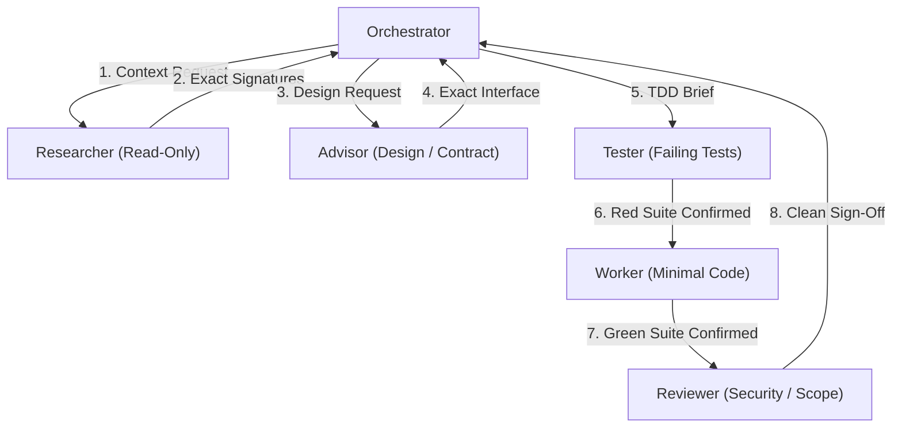
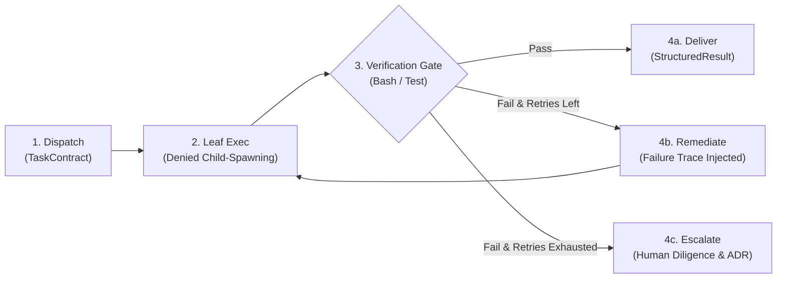

# PROTOCOL: SUBAGENT DISPATCH & DELEGATION

> High-density, minimal-token delegation between orchestrators and specialized subagents.

## 1. Why Scoped Dispatch Saves Tokens

| Naive Subagent Dispatch | Scoped Orchestra Dispatch |
|---|---|
| Ingests entire parent conversation history (20k–50k tokens) | Receives only the isolated Execution Brief (< 800 tokens) |
| Wanders through unrelated codebase files | Given exact target file paths and symbols |
| Ambiguous completion criteria leads to endless iterations | Bounded stop condition and explicit verification command |

## 2. Specialist Agent Roles



| Specialist | Role | Permissions | Expected Output |
|---|---|---|---|
| **Researcher** | Investigates codebase, maps call graphs | Read-Only | Concise summary of target functions, signatures, and constraints |
| **Advisor** | Designs architecture, writes contracts | Text-Only (No code edits) | Typed interface specification, schema, and edge-case list |
| **Tester** | Writes and verifies automated tests | Test Files Only | Failing test (RED) then green test execution log |
| **Worker** | Implements the minimal solution | Target Source Files Only | Unified diff satisfying the contract and passing tests |
| **Reviewer** | Audits diff for bugs, secrets, scope | Read-Only | PASS / FAIL verdict with exact line-number findings |

## 3. The Execution Brief Schema

When delegating a task to any subagent, the prompt MUST strictly adhere to this schema:

```markdown
### TASK EXECUTION BRIEF
- **Objective**: [1 sentence describing the single goal]
- **Target Files**: [Exact paths to inspect or modify]
- **Contract / Interface**: [Function signature, schema, or expected behavior]
- **Verification Command**: [Exact bash command to verify work]
- **Constraints**: [What NOT to touch, performance bounds, tier limits]
- **Stop Condition**: [When the agent must halt and return]
```

## 4. Synthesis & Conflict Resolution

1. **Orchestrator Holds Authority**: The orchestrator reviews each subagent's output against the brief before accepting.
2. **Reviewer Has Veto**: If the Reviewer reports a security vulnerability or scope creep, the Worker must rectify the diff before returning to user.
3. **Escalation to User**: If specialists disagree on design trade-offs, halt execution and present the options directly to the user with an ADR recommendation.

## 5. Closed-Loop Delegation Lifecycle

Orchestra enforces an acyclic 4-phase delegation loop that eliminates infinite subagent recursion and guarantees verified execution:



1. **Brief Dispatch (Orchestrator &rarr; Specialist)**: Orchestrator issues a scoped `TaskContract` with bounded file targets, token limits, and an objective.
2. **Leaf Execution**: Specialist agents operate with `action: subagent -> deny`. They cannot spawn or re-delegate tasks, preventing infinite loops.
3. **Deterministic Verification Gate**: `WorkflowVerifier` runs the command on disk. The agent is never permitted to self-certify.
4. **Remediation & Compounding Learning**:
   * **Remediation**: Upon failure, stdout/stderr is injected into `contract.input_artifacts["last_failure_reason"]` for targeted repair.
   * **Escalation**: On exhausted retries, an escalation notice is emitted to `.orchestra/escalations/` for human review.
   * **Compounding Rules**: Historical patterns in SQLite analytics are audited via `orch learn` to refine engineering standards over time.
