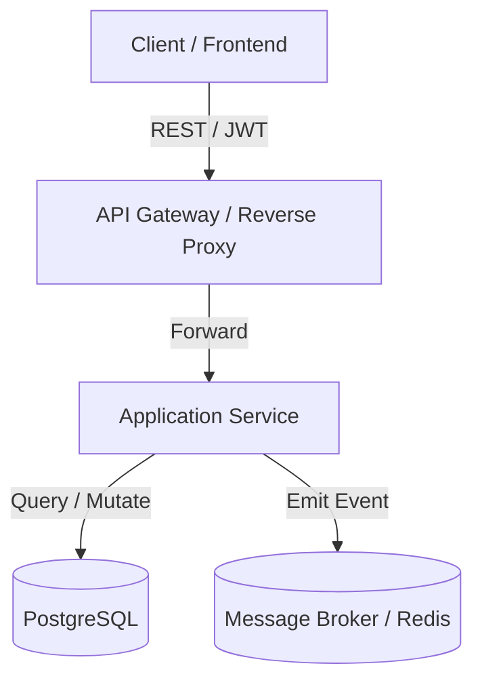

# SKILL ADAPTER: ARCHIFY

> Architectural modeling, system diagrams, and visualization generator.

## Overview
- **Trigger**: System design documentation, sequence flows, database ER diagrams, API topology, or state machines.
- **Pipeline Stage**: `Architecture & Technical Documentation`
- **Output**: Validated Mermaid code, SVG system diagrams, C4 model layers.

## Core Guidelines
1. **Use Supported Mermaid Formats**:
   - Component & Flow: `flowchart TD` / `flowchart LR`
   - Interaction & Protocols: `sequenceDiagram`
   - State Machines: `stateDiagram-v2`
   - Data Models: `erDiagram`
   - Class Structures: `classDiagram`
2. **Syntax Safety**:
   - Always quote node labels containing brackets, parentheses, or punctuation: `node["Label (Details)"]`.
   - Never use raw HTML tags inside node labels.
   - Keep diagrams focused: 7–15 nodes per diagram maximum to prevent visual clutter.

## Example Flowchart Pattern

