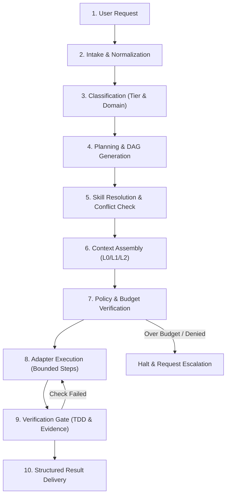

# Orchestra Execution Lifecycle Specification

Orchestra executes every task through a deterministic, verified 10-stage lifecycle:

## Lifecycle Stages

1. **Intake**: Accept task string, CLI flags, or programmatic input. Normalize white-space and identify command triggers (`/caveman`, `@researcher`).
2. **Classification**: Categorize into an execution tier (`Tiny`, `Normal`, `Complex`, `Architectural`) based on contract risk, file scope, and domain keywords.
3. **Planning**: Select or generate a declarative DAG workflow with explicit dependencies, timeouts, and acceptance criteria.
4. **Skill Resolution**: Discover eligible skills, rank candidates, expand dependencies, check for cycles and conflicts, and select the optimal leaf skill.
5. **Context Assembly**: Assemble the context manifest using progressive disclosure:
   - L0 (Constitution) + L1 (Router) + L2 (Selected Skill Leaf) + L3 (Active Artifacts).
6. **Policy & Budget Verification**: Check remaining budget quotas, evaluate path restrictions, and ensure required approval gates are satisfied.
7. **Adapter Execution**: Dispatch bounded task contracts (`task-contract.json`) to the active adapter (OpenCode, Antigravity, or Mock) in topological DAG order.
8. **Verification Gate**: Execute verification commands on disk (e.g. `pytest`, `npm test`, linter). Require non-zero exit codes to be addressed.
9. **Result Formatting**: Package results into structured records (`structured-result.json` / `verification-report.json`).
10. **Delivery**: Deliver minimal verified diff and concise summary to the user in high-density Caveman voice.
